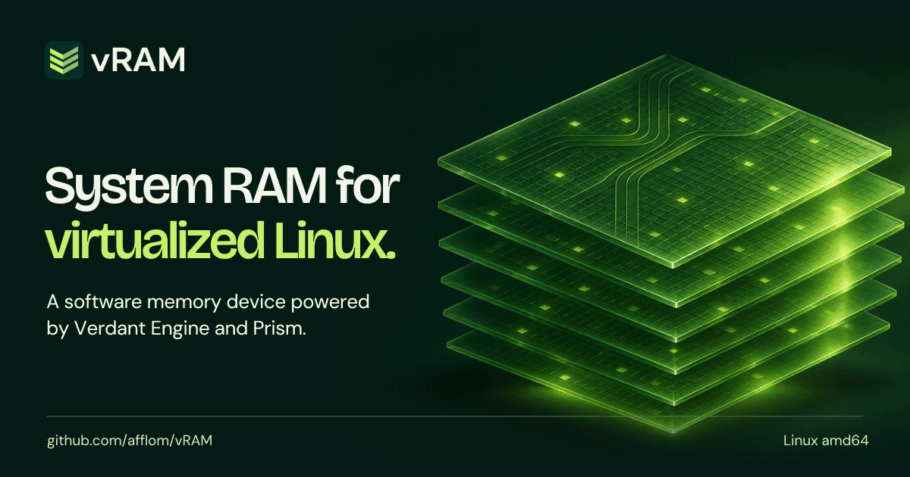

# vRAM brand guide

<picture>
  <source media="(prefers-color-scheme: dark)" srcset="../site/assets/wordmark-light.svg">
  
</picture>

Write the name **vRAM**, with a lowercase v. Preserve the executable names `vram-machine` and `vram-host` in commands. Use **Verdant Engine** and **Prism** on first mention.

## Product messaging

### Headline
System RAM for virtualized Linux.

### Short description
vRAM supplies System RAM to a Linux workstation running on QEMU/KVM. Verdant Engine stores its memory pages, and Prism guides how each page is represented and reconstructed.

### Release and installation copy
Use `vram-machine` to plan a workstation’s RAM target, qualify its backing storage, and boot an existing VM disk. Linux applications see the provisioned memory in the guest’s `MemTotal`. For directly booted Linux, describe the separate `vram-host` service as volatile swap and point readers to `SwapTotal`. [Install and use vRAM](../README.md#install-on-a-linux-computer)

Describe capacity in terms of the configured guest ceiling, firmware maximum and reserved backing. Pair each latency, throughput or storage claim with the workload, units and measurement. A store readback rate and an application benchmark answer different questions. [Device verification and measurements](device-verification.md)

## Mark and color

Three folded pages form the V. At tab size their silhouette identifies vRAM. Beside the wordmark they introduce the layered geometry used in the larger illustrations. Set the mark at 16 px or larger and the full signature at 96 px or larger. Leave at least one eighth of the mark’s height as clear space around the outside of the signature. Scale each SVG proportionally.

| Surface or use | Asset |
| --- | --- |
| Standalone square mark | [Scalable mark](../site/assets/mark.svg) |
| Paper or other light background | [Forest-ink wordmark](../site/assets/wordmark.svg) |
| Forest ink or other dark background | [Paper wordmark](../site/assets/wordmark-light.svg) |
| Browser tab | [SVG favicon](../site/assets/favicon.svg) · [ICO in 16, 24, 32, 48 and 64 px](../site/assets/favicon.ico) |
| Mobile home screen | [180 × 180 touch icon](../site/assets/apple-touch-icon.png) |

| Color | Value | Role |
| --- | --- | --- |
| Forest ink | `#062e27` | Mark ground, dark field, primary action on paper |
| Paper | `#f4f6ed` | Light reading surface and reversed lettering |
| Signal lime | `#c5f16a` | Fold face, highlight and action on dark surfaces |
| Jade | `#17815c` | Supporting illustration and data accents |
| Fold green | `#94d573` | Second face of the mark |

Use the site's semantic colors for body text, links, rules and controls. System theme follows the OS preference. Light and Dark select the corresponding palette and persist in the browser when storage is available. On charts, pair color with a visible label, shape or pattern. [Theme tokens and layouts](../site/styles.css)

## Typesetting and figures

Use Bricolage Grotesque for headings, generally at weight 600 and at 650 for the home page headline. Set prose and interface labels in DM Sans. The site sets body copy at 1 rem with a 1.6 line height. Use the system monospace stack and tabular numerals for code, commands and aligned measurements. Both web fonts are self-hosted under the SIL Open Font License. [Bricolage Grotesque license](../site/assets/fonts/bricolage-grotesque-OFL.txt) · [DM Sans license](../site/assets/fonts/dm-sans-OFL.txt)

Give each chart a question it answers, label the units and scope, and keep the values available as text. Caption the layered memory artwork as an illustration. If an image repeats information already announced by adjacent text, use an empty alt attribute. A standalone logo can use “vRAM” as its accessible name.

## Product and sharing artwork

The hero illustrates memory pages as a stack of etched green planes. Keep the profile of the layered edges visible when cropping. Use the WebP for the site and the PNG for Open Graph, social cards and announcements. The preview includes the product name and short headline inside its canvas so they travel with the image.

| Asset | Size | File |
| --- | --- | --- |
| Hero illustration | 1536 × 1024 | [WebP artwork](../site/assets/hero.webp) |
| Link preview | 1200 × 630 | [Shareable PNG](../site/assets/social-preview.png) |
| Editable preview composition | 1200 × 630 | [Self-contained SVG](brand/social-preview.svg) |

The mark and wordmark are original vector paths. The layered-plane illustration was generated for vRAM with OpenAI ImageGen. The editable preview embeds that illustration, vector lettering and the vRAM signature. To regenerate the PNG from the repository root, run the command below. [Repository licensing](../LICENSE)

```sh
inkscape docs/brand/social-preview.svg --export-filename=site/assets/social-preview.png
```


